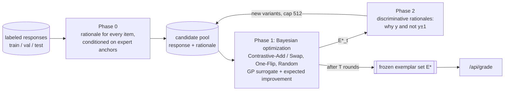

# guide-exemplars

**Boundary-focused in-context exemplar optimization for LLM-based grading.** 

This is an independent, domain-agnostic implementation of **GUIDE** (*Grading Using Iteratively Designed Exemplars*)
from Chu et al., *Optimizing In-Context Demonstrations for LLM-based Automated Grading*
([arXiv:2603.00465](https://arxiv.org/abs/2603.00465), 2026).

When an LLM grades with few-shot demonstrations, which demonstrations it sees matters more than almost anything else.
GUIDE optimizes that demonstration selection:

- It searches for **boundary pairs**: responses that look alike but sit one score level apart.
- It optimizes a small, **fixed** demonstration set with Bayesian optimization.
- It rewrites each rationale to say why the response earns *its* score **and not the neighbouring one**.

The result is a frozen exemplar set you can deploy behind a grading endpoint.

**For your convenience, try the [walkthrough](docs/walkthrough/README.md):** the results, how to read them, and a screenshot
tour of the dashboard.



## What's here

| | |
|---|---|
| **Library** (`guide_exemplars.core`) | Pure Python plus numpy, scipy and sklearn. Ordinal label scales (numbered or named), boundary graph, contrastive operators, GP/EI selection, the T-round optimizer with checkpoints and resume, baselines (Naive, Random, KNN-SBERT, Vote-k), and a cost estimator. No web or DB dependencies. |
| **LLM layer** (`guide_exemplars.llm`) | One client for every backend: response cache, then reservation-based **hard spend cap**, then a concurrency limit, then the provider, then cost metering. Works with OpenAI and any OpenAI-compatible server (vLLM, SGLang, Ollama, OpenRouter…). LiteLLM is optional. There's also a deterministic fake backend with a simulated grader for offline runs. |
| **Service** (`guide_exemplars.service`) | FastAPI on SQLite: tasks, datasets, background optimization jobs (cancel, resume after crash, budget stop), Server-Sent Events, versioned immutable exemplar sets, and `/api/grade`. |
| **Dashboard** (`/`) | Live job progress, convergence chart, PCA map of the candidate pool with boundary-pair edges and the chosen exemplars, exemplar cards, and a grade box. |
| **Benchmark** (`guide benchmark`) | Matrix runner: GUIDE vs baselines and ablations on a held-out test split, with paired bootstrap CIs and a manifest. A cache-only `--replay` reproduces the results byte for byte. |

Nothing is essay-specific. Every piece of domain text (persona, instruction, rubric, level descriptions, context,
what a rationale should focus on) lives in a [TaskSpec YAML](configs/tasks/asap-aes-p7-conventions.yaml).

## Results

<!-- RESULTS:START -->
### Benchmark `gpt4o-mini-headline`

Backbone `openai/gpt-4o-mini`, seeds [0], test split, 95% percentile-bootstrap CIs (B=2000). Spend $21.17.

**aes-p7** (test n=311; human rater1 vs rater2: acc 0.624, QWK 0.599)

| Method | k | Acc | QWK | AdjErr | NonAdjErr |
|---|---:|---:|---:|---:|---:|
| **guide** | 10 | 0.621 [0.566, 0.675] | 0.380 [0.291, 0.465] | 0.363 [0.309, 0.418] | 0.016 [0.003, 0.032] |
| naive | 10 | 0.399 [0.347, 0.453] | 0.234 [0.161, 0.308] | 0.486 [0.431, 0.540] | 0.116 [0.080, 0.154] |
| random | 10 | 0.488 [0.442, 0.536] | 0.315 [0.252, 0.376] | 0.457 [0.413, 0.500] | 0.055 [0.035, 0.076] |
| knn | 10 | 0.514 [0.460, 0.569] | 0.358 [0.286, 0.431] | 0.460 [0.405, 0.514] | 0.026 [0.010, 0.045] |
| vote_k | 10 | 0.376 [0.328, 0.434] | 0.152 [0.093, 0.213] | 0.514 [0.460, 0.569] | 0.109 [0.074, 0.145] |

Reference: always predicting the most common score (level 2) gives accuracy 0.579 and QWK 0.

Predicted score counts on the test split (mean per draw for multi-draw methods):

| | level 0 | level 1 | level 2 | level 3 | failed |
|---|---:|---:|---:|---:|---:|
| *gold* | 2 | 65 | 180 | 64 | |
| guide | 1 | 73 | 234 | 3 | 0 |
| naive | 25 | 166 | 118 | 2 | 0 |
| random | 7.2 | 145 | 157.8 | 1 | 0 |
| knn | 3 | 127 | 180 | 1 | 0 |
| vote_k | 1 | 214 | 95 | 1 | 0 |

Paired GUIDE - method (accuracy): naive +0.222 [+0.161, +0.280], P(Δ>0)=1.00; random +0.132 [+0.087, +0.177], P(Δ>0)=1.00; knn +0.106 [+0.055, +0.161], P(Δ>0)=1.00; vote_k +0.244 [+0.180, +0.305], P(Δ>0)=1.00
<!-- RESULTS:END -->

**Datasets.**
- *ASAP-AES* prompt 7, the Conventions trait. Rater scores are combined by dropping items whose two raters differ by
  2 or more and otherwise taking the lower score. That keeps 1,553 essays, split 927 train / 311 val / 311 test / 4
  expert. The human ceiling, rater 1 vs rater 2, is accuracy 0.624 and QWK 0.599.
- *ASAP-SAS*: four short-answer prompts (sets 1, 5, 3, 7).

Both datasets are Kaggle competitions. They are not redistributed here; see [Data](#data).

## Quick start

```bash
uv venv --python 3.12
uv pip install -e ".[llm,data,service,dev]"      # add ,local-embed for the KNN-SBERT baseline (CPU torch)
cp .env.example .env                             # add OPENAI_API_KEY for real runs
uv run pytest                                    # ~215 tests, fully offline

# Data (Kaggle account + accepted competition rules), then split it
uv run guide data fetch asap-aes                 # or place training_set_rel3.tsv in data/raw/asap-aes/
uv run guide data prepare aes-p7

# Try everything offline with the simulated grader (free)
uv run guide optimize --preset aes-p7 --backbone fake --train-limit 80 --val-limit 40 \
    --set n_rounds=2 --set n_eval=10 --set tau=0.5
uv run guide benchmark smoke-fake

# Real runs: always look at the estimate first
uv run guide optimize --preset aes-p7 --backbone gpt4o-mini --dry-run
uv run guide benchmark gpt4o-mini-headline --dry-run

# Service + dashboard (the bundled synthetic `demo` preset needs no Kaggle download)
uv run guide serve                               # http://127.0.0.1:8000  (API docs at /docs)
docker compose up --build                        # same, containerized
```

## API
```bash
B=http://127.0.0.1:8000/api
# 1. a task (rubric, levels, persona…) and labeled data (CSV/JSONL: item_id,text,label[,split])
curl -X POST $B/tasks -H 'content-type: application/yaml' --data-binary @configs/tasks/asap-aes-p7-conventions.yaml
curl -X POST $B/datasets -F task_id=<task_id> -F file=@my_responses.csv
#    ...or import a prepared benchmark preset with its split:
curl -X POST $B/datasets/from-preset -H 'content-type: application/json' -d '{"preset":"aes-p7","train_limit":200,"val_limit":60}'

# 2. estimate, then start an optimization (the key is optional and held in memory only)
curl -X POST $B/jobs -H 'content-type: application/json' \
     -d '{"task_id":"…","dataset_id":"…","backbone":"gpt4o-mini","max_cost_usd":5,"dry_run":true}'
curl -X POST $B/jobs -H 'content-type: application/json' -H "x-llm-api-key: $OPENAI_API_KEY" \
     -d '{"task_id":"…","dataset_id":"…","backbone":"gpt4o-mini","max_cost_usd":5}'
curl -N $B/jobs/<job_id>/events            # live progress (SSE, resumable with Last-Event-ID)

# 3. grade with the frozen set
curl -X POST $B/grade -H 'content-type: application/json' \
     -d '{"set":{"task_id":"…","name":"asap-aes-p7-conventions","version":"latest"},"responses":[{"id":"a","text":"…"}]}'
```

Jobs can be cancelled or resumed. A job that is cancelled or hits its cap still publishes the best fully evaluated set
as a `partial` version. After a crash the job is marked `interrupted` and resumes from its last phase checkpoint.
Seeded RNG streams and the response cache make the resumed run identical to an uninterrupted one.

## Fidelity to the paper

The defaults follow the paper wherever it is specific: T = 5 rounds, 32 evaluations per round, |E| ∈ [4, 16],
τ = 0.7, 256 acquisition candidates, pool cap 512, temperature 0.2, GPT-4o-mini with text-embedding-3-small, and a
3:1:1 split. Where the paper leaves a detail open, or a literal reading works poorly, the improved choice is the
default. `paper_literal: true` switches every one of those back, and the benchmark runs both.

| Detail | Default here | `paper_literal` | Why |
|---|---|---|---|
| GP input | mean PCA-16 embedding + label histogram + size | binary membership over the pool | With ~32 observations per round over a 512-item pool, membership vectors leave the GP close to its prior, so EI degenerates into near-random search. Set features generalize to unseen sets. |
| Contrastive score | *coverage*: share of members with an adjacent-level partner at cos ≥ τ | boundary pairs / C(n, 2), any differing labels | Pair-ratio shrinks quadratically with set size, which duplicates the sparsity term. The operators already use adjacent levels (the paper's C_i). |
| Pool cap | always keeps the current E*_t | uniform random beyond the experts | Round t+1 must be able to re-score the incumbent. |
| Final pick | best over all rounds (lexicographic: accuracy, contrastive, −size) | best of the last round | Validation set and grader are fixed, so accuracies are comparable across rounds. |

Correctness details the paper doesn't spell out, all tested:
- The round-local incumbent and E*_{t−1} are re-seeded into round t, so the operators never perturb a stale set.
- The objective is re-scalarized over the whole history for every suggestion, with fresh weights and the current
  Acc*.
- The sparsity term uses the paper's raw −|E|. Dividing by k_max lets set size outweigh accuracy inside the max.
- Phase 2 makes one call per item, and the context never contains the item's own rationale.
- Failed grading calls count as wrong; they are never silently dropped.
- Exemplar identity is by (item, rationale) hash, so rationale variants don't collide.
- Exactly 256 unique, unevaluated candidates per step.

**Bootstrapped experts.** Public data has no expert rationales, so one training item per level is designated an
"expert" anchor. Its rationale is generated without context and then protected from swaps, flips and the cap. These
are not human-written rationales.

## Costs and reproducibility

- `--dry-run` and `POST /api/jobs {"dry_run": true}` estimate calls, tokens, minutes and dollars from the actual
  rendered prompts. A small GPT-4o-mini calibration run came in at $0.054 against a $0.06–0.10 estimate.
- The demonstrations come before the scored response, so OpenAI's automatic prefix cache served 84% of grading input
  tokens.
- `max_cost_usd` is a hard cap. Every call reserves its worst-case cost before it is sent, so concurrent calls can
  never overshoot. Hitting the cap ends the job cleanly with the best set found so far.
- Every LLM response is cached in SQLite, keyed by model, endpoint, temperature, token limit and messages. Reruns are
  free. `guide benchmark <matrix> --replay` fails on any cache miss, which proves a published table reproduces from
  the recorded responses.
- Each benchmark writes a `manifest.json` with the git SHA, package version, split hashes and raw-file checksums.

## Data

| Preset | Source | Get it |
|---|---|---|
| `aes-p7` | [ASAP-AES](https://www.kaggle.com/c/asap-aes) `training_set_rel3.tsv`, essay set 7, trait 4 | `guide data fetch asap-aes` |
| `sas` | [ASAP-SAS](https://www.kaggle.com/c/asap-sas) `train.tsv`, sets 1, 5, 3, 7 | `guide data fetch asap-sas` |
| your own | CSV/JSONL with `item_id,text,label[,split]` plus a TaskSpec | `POST /api/datasets` or a preset YAML with `kind: file` |

The rubric wording in the task specs was written for this repo from the public ASAP scoring guides. Raw data, response
text and rationales are never committed; only aggregate benchmark summaries are.

## Layout

```
src/guide_exemplars/
  core/        scale, task, pool, rng, metrics, prompts (+ Jinja templates), contrastive, featurize, objective,
               bo, grader, rationale, optimizer, checkpoint, estimate, selectors/
  llm/         client (cache, budget, meter), OpenAI-compatible / LiteLLM / fake backends, embedders, backbones
  data/        ASAP loaders, splits, presets, Kaggle fetch
  benchmark/   matrix, runner, bootstrap, report
  service/     FastAPI app, SQLite store, worker, SSE bus, routes
  web/static/  dashboard (vanilla JS + Plotly)
configs/       tasks/, presets/, benchmarks/, backbones.yaml, pricing.yaml
```

## Citation

```bibtex
@article{chu2026guide,
  title   = {Optimizing In-Context Demonstrations for LLM-based Automated Grading},
  author  = {Chu, Yucheng and Li, Hang and Yang, Kaiqi and Copur-Gencturk, Yasemin and Haudek, Kevin and
             Krajcik, Joseph and Tang, Jiliang},
  journal = {arXiv preprint arXiv:2603.00465},
  year    = {2026}
}
```

## License

MIT for the code. ASAP-AES and ASAP-SAS are distributed by Kaggle under their own competition terms.
