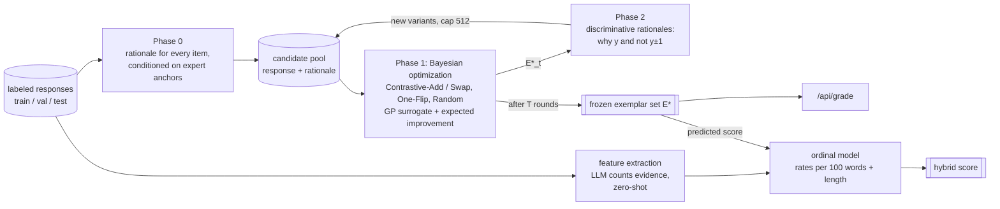

# guide-exemplars

**Boundary-focused in-context exemplar optimization for LLM-based grading.**

**The problem: LLMs don't grade like people.** Out of the box, LLM scores agree only weakly with human grades, and
the models rely on different signals. Compared with human raters they give short, underdeveloped essays higher
scores, and longer essays with minor spelling or grammar errors lower ones
([Mathew et al., 2026](https://doi.org/10.1016/j.caeai.2026.100666)). They also compress scores toward the middle of
the scale. We see both effects on our headline benchmark: human raters gave 64 of 311 test essays the top score
(3), and `gpt-4o-mini`, even with optimized examples, gave it only 3 times, calling 234 essays a "2" where
humans called 180. The essays it misses are long ones with small, easily fixed errors.

This repo narrows the gap with two graders that work together:

- **Exemplar optimization.** When an LLM grades with few-shot demonstrations, which demonstrations it sees matters
  more than almost anything else, and the search optimizes that selection. Examples chosen at the score boundaries
  show the model where human raters draw the lines between levels. It looks for **boundary pairs**:
  responses that look alike but sit one level apart. It optimizes a small, **fixed** example set with Bayesian
  optimization, and rewrites each rationale to say why the response earns *its* score **and not the neighbouring
  one**. The method adapts **GUIDE** (Chu et al., 2026, [arXiv:2603.00465](https://arxiv.org/abs/2603.00465)).
- **A feature grader and a hybrid.** An LLM counts rubric evidence in each response, zero-shot (for writing
  conventions: errors a reader fixes without effort, and errors that block meaning). Counts become rates per 100
  words, so a long essay isn't marked down for its length. A small ordinal model turns the rates into a score,
  fitted to human scores. The **hybrid** adds the exemplar grader's prediction as one more input.

On the headline benchmark the exemplar grader is the most accurate of the LLM graders, but it almost never gives the
top score. The hybrid keeps that accuracy and reaches human-level agreement (QWK 0.597 vs 0.599 between the two
human raters). The output is a frozen exemplar set plus a fitted model, which you can deploy behind a grading
endpoint.

**For your convenience, try the [walkthrough](docs/walkthrough/README.md):** the results, how to read them, and a screenshot
tour of the dashboard.



## What's here

| | |
|---|---|
| **Library** (`guide_exemplars.core`) | Pure Python plus numpy, scipy and sklearn. Ordinal label scales (numbered or named), boundary graph, contrastive operators, GP/EI selection, the T-round optimizer with checkpoints and resume, baselines (Naive, Random, KNN-SBERT, Vote-k), the feature extractor and ordinal model, and a cost estimator. No web or DB dependencies. |
| **LLM layer** (`guide_exemplars.llm`) | One client for every backend: response cache, then reservation-based **hard spend cap**, then a concurrency limit, then the provider, then cost metering. Works with OpenAI and any OpenAI-compatible server (vLLM, SGLang, Ollama, OpenRouter…). LiteLLM is optional. There's also a deterministic fake backend with a simulated grader for offline runs. |
| **Service** (`guide_exemplars.service`) | FastAPI on SQLite: tasks, datasets, background optimization jobs (cancel, resume after crash, budget stop), Server-Sent Events, versioned immutable exemplar sets, and `/api/grade`. |
| **Dashboard** (`/`) | Live job progress, convergence chart, PCA map of the candidate pool with boundary-pair edges and the chosen exemplars, exemplar cards, and a grade box. |
| **Benchmark** (`guide benchmark`) | Matrix runner: the exemplar grader, its ablations, four exemplar baselines, the feature grader and the hybrid on a held-out test split, with paired bootstrap CIs and a manifest. A cache-only `--replay` reproduces the results byte for byte. |

Nothing is essay-specific. Every piece of domain text (persona, instruction, rubric, level descriptions, context,
what a rationale should focus on, what the feature grader counts) lives in a
[TaskSpec YAML](configs/tasks/asap-aes-p7-conventions.yaml).

## Results

<!-- RESULTS:START -->
### Benchmark `gpt4o-mini-headline`

Backbone `openai/gpt-4o-mini`, seeds [0], test split, 95% percentile-bootstrap CIs (B=2000). Spend $21.59.

**aes-p7** (test n=311; human rater1 vs rater2: acc 0.624, QWK 0.599)

| Method | k | Acc | QWK | AdjErr | NonAdjErr |
|---|---:|---:|---:|---:|---:|
| **guide** | 10 | 0.621 [0.566, 0.675] | 0.380 [0.291, 0.465] | 0.363 [0.309, 0.418] | 0.016 [0.003, 0.032] |
| naive | 10 | 0.399 [0.347, 0.453] | 0.234 [0.161, 0.308] | 0.486 [0.431, 0.540] | 0.116 [0.080, 0.154] |
| random | 10 | 0.488 [0.442, 0.536] | 0.315 [0.252, 0.376] | 0.457 [0.413, 0.500] | 0.055 [0.035, 0.076] |
| knn | 10 | 0.514 [0.460, 0.569] | 0.358 [0.286, 0.431] | 0.460 [0.405, 0.514] | 0.026 [0.010, 0.045] |
| vote_k | 10 | 0.376 [0.328, 0.434] | 0.152 [0.093, 0.213] | 0.514 [0.460, 0.569] | 0.109 [0.074, 0.145] |
| feature | 0 | 0.585 [0.531, 0.640] | 0.590 [0.510, 0.659] | 0.405 [0.350, 0.463] | 0.010 [0.000, 0.023] |
| hybrid | 10 | 0.630 [0.579, 0.685] | 0.597 [0.509, 0.670] | 0.357 [0.302, 0.408] | 0.013 [0.003, 0.026] |

Reference: always predicting the most common score (level 2) gives accuracy 0.579 and QWK 0.

Predicted score counts on the test split (mean per draw for multi-draw methods):

| | level 0 | level 1 | level 2 | level 3 | failed |
|---|---:|---:|---:|---:|---:|
| *gold* | 2 | 65 | 180 | 64 | |
| guide | 1 | 73 | 234 | 3 | 0 |
| naive | 25 | 166 | 118 | 2 | 0 |
| random | 7.2 | 145 | 157.8 | 1 | 0 |
| knn | 3 | 127 | 180 | 1 | 0 |
| vote_k | 1 | 214 | 95 | 1 | 0 |
| feature | 12 | 72 | 135 | 92 | 0 |
| hybrid | 8 | 82 | 144 | 77 | 0 |

Paired GUIDE - method (accuracy): naive +0.222 [+0.161, +0.280], P(Δ>0)=1.00; random +0.132 [+0.087, +0.177], P(Δ>0)=1.00; knn +0.106 [+0.055, +0.161], P(Δ>0)=1.00; vote_k +0.244 [+0.180, +0.305], P(Δ>0)=1.00; feature +0.035 [-0.042, +0.109], P(Δ>0)=0.79; hybrid -0.010 [-0.080, +0.061], P(Δ>0)=0.37

Paired GUIDE - method (QWK): naive +0.147 [+0.073, +0.220], P(Δ>0)=1.00; random +0.066 [+0.006, +0.121], P(Δ>0)=0.98; knn +0.022 [-0.055, +0.098], P(Δ>0)=0.71; vote_k +0.228 [+0.145, +0.308], P(Δ>0)=1.00; feature -0.210 [-0.300, -0.119], P(Δ>0)=0.00; hybrid -0.216 [-0.294, -0.135], P(Δ>0)=0.00
<!-- RESULTS:END -->

**Reading the table.** `guide` is the exemplar grader alone, `feature` is the ordinal model on counted evidence, and
`hybrid` is the same model with `guide`'s predicted score as an extra input. Three things stand out:
- The exemplar grader beats every other way of choosing examples on accuracy.
- It predicts the top score 3 times for 64 essays that earned it. `gpt-4o-mini` can't separate a 3 from a 2 on
  this trait (see the [walkthrough](docs/walkthrough/README.md#8--how-its-evaluated)).
- The counted evidence fixes that. The hybrid beats the exemplar grader on QWK by +0.216 [+0.135, +0.294] and is
  as accurate. It is more accurate than the feature grader alone by +0.045 [+0.006, +0.080].

**Datasets.**
- *ASAP-AES* prompt 7, the Conventions trait. Rater scores are combined by dropping items whose two raters differ by
  2 or more and otherwise taking the lower score. That keeps 1,553 essays, split 927 train / 311 val / 311 test / 4
  expert. The human ceiling, rater 1 vs rater 2, is accuracy 0.624 and QWK 0.599.
- *ASAP-SAS*: four short-answer prompts (sets 1, 5, 3, 7).

Both datasets are Kaggle competitions. They are not redistributed here; see [Data](#data).

## Quick start

```bash
uv venv --python 3.12
uv pip install -e ".[llm,data,service,dev]"      # add ,local-embed for the KNN-SBERT baseline (CPU torch)
cp .env.example .env                             # add OPENAI_API_KEY for real runs
uv run pytest                                    # ~230 tests, fully offline

# Data (Kaggle account + accepted competition rules), then split it
uv run guide data fetch asap-aes                 # or place training_set_rel3.tsv in data/raw/asap-aes/
uv run guide data prepare aes-p7

# Try everything offline with the simulated grader (free)
uv run guide optimize --preset aes-p7 --backbone fake --train-limit 80 --val-limit 40 \
    --set n_rounds=2 --set n_eval=10 --set tau=0.5
uv run guide benchmark smoke-fake

# Real runs: always look at the estimate first
uv run guide optimize --preset aes-p7 --backbone gpt4o-mini --dry-run
uv run guide benchmark gpt4o-mini-headline --dry-run

# Service + dashboard (the bundled synthetic `demo` preset needs no Kaggle download)
uv run guide serve                               # http://127.0.0.1:8000  (API docs at /docs)
docker compose up --build                        # same, containerized
```

## API
```bash
B=http://127.0.0.1:8000/api
# 1. a task (rubric, levels, persona…) and labeled data (CSV/JSONL: item_id,text,label[,split])
curl -X POST $B/tasks -H 'content-type: application/yaml' --data-binary @configs/tasks/asap-aes-p7-conventions.yaml
curl -X POST $B/datasets -F task_id=<task_id> -F file=@my_responses.csv
#    ...or import a prepared benchmark preset with its split:
curl -X POST $B/datasets/from-preset -H 'content-type: application/json' -d '{"preset":"aes-p7","train_limit":200,"val_limit":60}'

# 2. estimate, then start an optimization (the key is optional and held in memory only)
curl -X POST $B/jobs -H 'content-type: application/json' \
     -d '{"task_id":"…","dataset_id":"…","backbone":"gpt4o-mini","max_cost_usd":5,"dry_run":true}'
curl -X POST $B/jobs -H 'content-type: application/json' -H "x-llm-api-key: $OPENAI_API_KEY" \
     -d '{"task_id":"…","dataset_id":"…","backbone":"gpt4o-mini","max_cost_usd":5}'
curl -N $B/jobs/<job_id>/events            # live progress (SSE, resumable with Last-Event-ID)

# 3. grade with the frozen set
curl -X POST $B/grade -H 'content-type: application/json' \
     -d '{"set":{"task_id":"…","name":"asap-aes-p7-conventions","version":"latest"},"responses":[{"id":"a","text":"…"}]}'
```

Jobs can be cancelled or resumed. A job that is cancelled or hits its cap still publishes the best fully evaluated set
as a `partial` version. After a crash the job is marked `interrupted` and resumes from its last phase checkpoint.
Seeded RNG streams and the response cache make the resumed run identical to an uninterrupted one.

## How it works

**The exemplar search** runs in rounds over a pool of candidate examples, each a response with its score and a
rationale. By default there are 5 rounds and 32 evaluated sets per round. Sets hold 4 to 16 examples, the
similarity threshold is τ = 0.7, there are 256 acquisition candidates per step, and the pool is capped at 512.

1. **Phase 0** writes a rationale for every training response, conditioned on one anchor example per level.
2. **Phase 1** proposes candidate sets with four operators: add the adjacent-level partner of a member, swap a
   member for one, flip one member, or draw at random. A Gaussian process with expected improvement picks the
   candidates worth grading on the validation split.
3. **Phase 2** rewrites the rationales of the round's best set to argue against both neighbouring levels. The new
   versions join the pool.

The objective mixes accuracy, set size and contrastive coverage. Its weights are redrawn at random for every
suggestion, and it is re-applied to the whole history each time:
`g(E) = max(w1·(Acc − Acc*), w2·(−|E|)) + w3·C(E)`.

Design choices, each set by its own `GuideConfig` field:

| Choice | Field | Why |
|---|---|---|
| The GP sees a set as its mean PCA-16 embedding, label histogram and size | `featurizer` | With ~32 observations per round over a 512-item pool, a membership vector leaves the GP near its prior, and expected improvement degenerates into random search. Set-level features generalize to sets it hasn't seen. |
| Contrastive score: the share of members with an adjacent-level partner at cosine ≥ τ | `contrastive_score`, `adjacent_only` | A pair count over C(n, 2) shrinks quadratically with set size and duplicates the size term. |
| The pool cap always keeps the current best set | `protect_incumbent` | The next round must be able to re-score the incumbent. |
| The final pick is the best set over all rounds | `final_selection` | The validation split and grader are fixed, so accuracies are comparable across rounds. |

Details that matter, all tested:
- The size term is the raw −|E|. Dividing it by the maximum set size lets size outweigh accuracy inside the `max`.
- The round's incumbent and the previous best set are re-seeded into each round, so the operators never perturb a
  stale set.
- Phase 2 makes one call per item, and the context never contains the item's own rationale.
- Failed grading calls count as wrong; they are never silently dropped.
- Exemplar identity is by (item, rationale) hash, so rationale variants don't collide.
- Each step draws exactly 256 unique, unevaluated candidates.

**Bootstrapped experts.** Public data has no expert rationales, so one training item per level is designated an
"expert" anchor. Its rationale is generated without context and then protected from swaps, flips and the cap. These
are not human-written rationales.

**The feature grader.** A task spec can declare what to count:

```yaml
features:
  instruction: Find the convention errors ... and sort them into the two kinds below.
  counts:
    - name: recoverable   # a reader understands the intended word instantly: "couldnt", a missing comma
    - name: obstructive   # a reader has to stop and reconstruct the meaning
  per_words: 100
  include_length: true
```

1. **Counts.** One zero-shot call per response, at temperature 0, returns the counts.
2. **Features.** The counts become rates per 100 words, so a long essay isn't penalized for having more errors in
   total. Log word count is added.
3. **Score.** A ridge regression maps the features to the score rank. Cut points on the regression score are chosen
   to maximize QWK on the training split.

The **hybrid** adds the exemplar grader's predicted score as one more column. It is fitted on the training split
minus the exemplars' own items, which costs one extra grading pass over train. Both methods record their
standardized coefficients in `metrics.json`. Tasks without a `features` block skip both.

## Costs and reproducibility

- `--dry-run` and `POST /api/jobs {"dry_run": true}` estimate calls, tokens, minutes and dollars from the actual
  rendered prompts. A small GPT-4o-mini calibration run came in at $0.054 against a $0.06–0.10 estimate.
- The demonstrations come before the scored response, so OpenAI's automatic prefix cache served 84% of grading input
  tokens.
- `max_cost_usd` is a hard cap. Every call reserves its worst-case cost before it is sent, so concurrent calls can
  never overshoot. Hitting the cap ends the job cleanly with the best set found so far.
- Every LLM response is cached in SQLite, keyed by model, endpoint, temperature, token limit and messages. Reruns are
  free. `guide benchmark <matrix> --replay` fails on any cache miss, which proves a published table reproduces from
  the recorded responses.
- Each benchmark writes a `manifest.json` with the git SHA, package version, split hashes and raw-file checksums.

## Data

| Preset | Source | Get it |
|---|---|---|
| `aes-p7` | [ASAP-AES](https://www.kaggle.com/c/asap-aes) `training_set_rel3.tsv`, essay set 7, trait 4 | `guide data fetch asap-aes` |
| `sas` | [ASAP-SAS](https://www.kaggle.com/c/asap-sas) `train.tsv`, sets 1, 5, 3, 7 | `guide data fetch asap-sas` |
| your own | CSV/JSONL with `item_id,text,label[,split]` plus a TaskSpec | `POST /api/datasets` or a preset YAML with `kind: file` |

The rubric wording in the task specs was written for this repo from the public ASAP scoring guides. Raw data, response
text and rationales are never committed; only aggregate benchmark summaries are.

## Layout

```
src/guide_exemplars/
  core/        scale, task, pool, rng, metrics, prompts (+ Jinja templates), contrastive, featurize, objective,
               bo, grader, rationale, optimizer, checkpoint, estimate, feature_grader, selectors/
  llm/         client (cache, budget, meter), OpenAI-compatible / LiteLLM / fake backends, embedders, backbones
  data/        ASAP loaders, splits, presets, Kaggle fetch
  benchmark/   matrix, runner, bootstrap, report
  service/     FastAPI app, SQLite store, worker, SSE bus, routes
  web/static/  dashboard (vanilla JS + Plotly)
configs/       tasks/, presets/, benchmarks/, backbones.yaml, pricing.yaml
```

## Citation

The exemplar search adapts GUIDE (Chu et al.). The problem statement draws on Mathew et al.

```bibtex
@article{mathew2026llms,
  title   = {{LLMs} do not grade essays like humans},
  author  = {Mathew, Jerin George and Taher, Sumayya and Kundu, Anindita and Barbosa, Denilson},
  journal = {Computers and Education: Artificial Intelligence},
  volume  = {11},
  pages   = {100666},
  year    = {2026},
  doi     = {10.1016/j.caeai.2026.100666}
}


@article{chu2026guide,
  title   = {Optimizing In-Context Demonstrations for LLM-based Automated Grading},
  author  = {Chu, Yucheng and Li, Hang and Yang, Kaiqi and Copur-Gencturk, Yasemin and Haudek, Kevin and
             Krajcik, Joseph and Tang, Jiliang},
  journal = {arXiv preprint arXiv:2603.00465},
  year    = {2026}
}
```

## License

MIT for the code. ASAP-AES and ASAP-SAS are distributed by Kaggle under their own competition terms.
