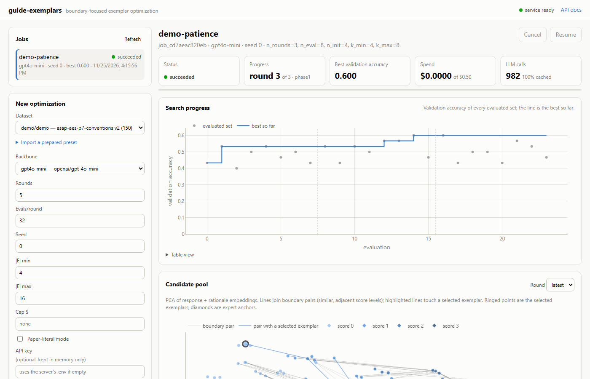
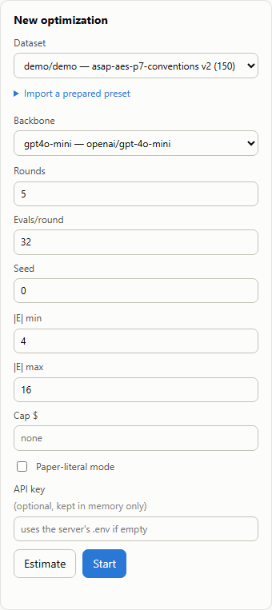
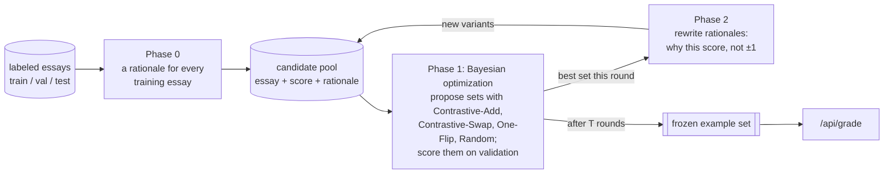
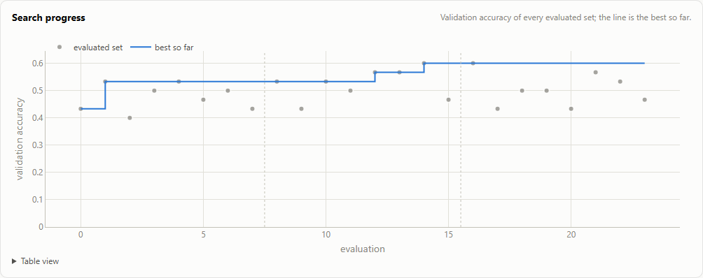
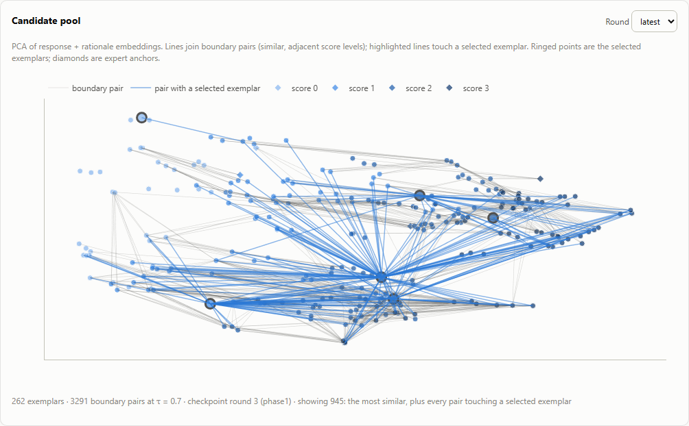
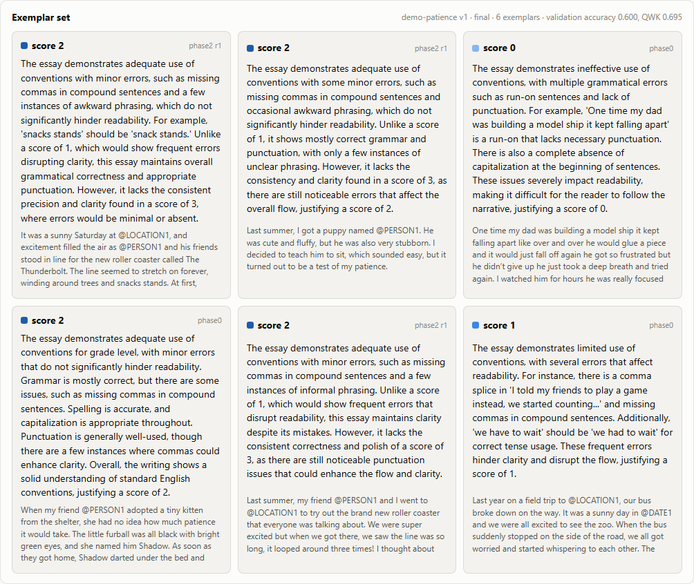
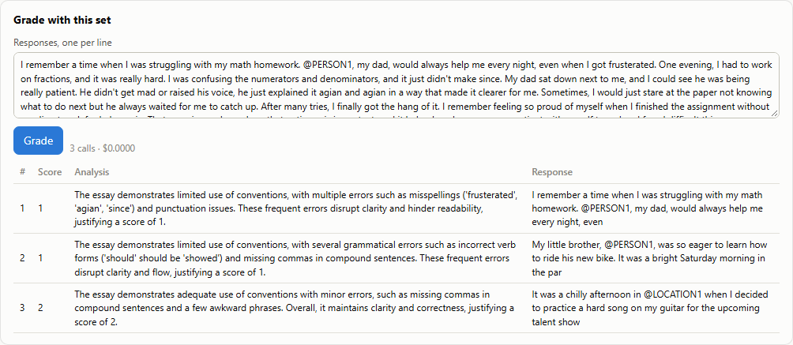
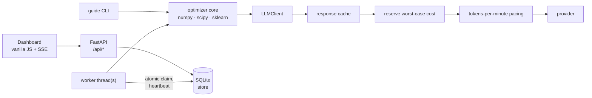
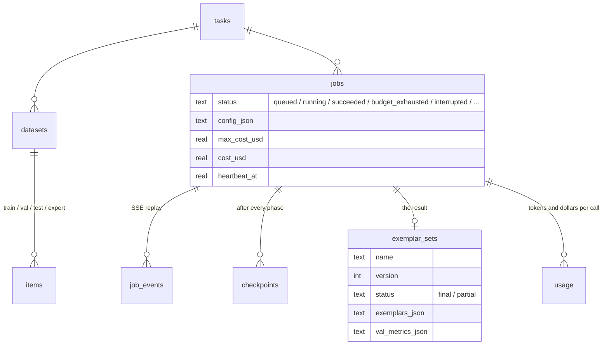

# guide-exemplars: a walkthrough

> **Which ten graded examples should an LLM see before it grades an essay?**

guide-exemplars is an independent implementation of GUIDE (Chu et al., 2026,
[arXiv:2603.00465](https://arxiv.org/abs/2603.00465)): a search for the small set of scored examples that makes an
LLM grade most accurately against a rubric. It looks for *boundary pairs*, essays that read alike but sit one score
apart, and rewrites each example's rationale to say why it earns its score and not the neighbouring one. The result
is a frozen, versioned example set behind a grading endpoint. It ships as a Python library, a CLI and a FastAPI
service with a live dashboard.

Every screenshot below was captured headlessly from a **real `gpt-4o-mini` job** by
[`scripts/screenshots.py`](../../scripts/screenshots.py). The job runs on a bundled set of **synthetic** grade 7
essays ([`configs/demo-data/`](../../configs/demo-data/)): the benchmark data is a Kaggle competition set that can't
be redistributed. The script refuses to capture any job whose dataset isn't the synthetic one, so no real student
essay can appear in a frame. The benchmark numbers in [section 7](#7--how-its-evaluated) come from the real data.

**Contents:**
[1 · The dashboard](#1--the-dashboard) ·
[2 · A task is data](#2--a-task-is-data-not-code) ·
[3 · The search](#3--the-search) ·
[4 · Boundary pairs](#4--boundary-pairs) ·
[5 · Grading with the set](#5--the-frozen-set-and-grading-with-it) ·
[6 · The service underneath](#6--the-service-underneath) ·
[7 · How it's evaluated](#7--how-its-evaluated)

---

## 1 · The dashboard



One page: the job list and a form to start a new optimization on the left, the selected job on the right. Status,
round, best validation accuracy, spend and call counts update live over Server-Sent Events while a job runs.

This frame shows a **re-run** of the demo job in a fresh database. All 982 of its LLM calls were answered from the
response cache, so it cost **$0.00** and reproduced the original's best validation accuracy of 0.600 exactly. The
original run cost $0.27 and took about two minutes. Every response is cached by model, endpoint, temperature, token
limit and messages, and the search is seeded, so a rerun follows the same path through the same prompts.

## 2 · A task is data, not code



Nothing in the code is essay-specific. A **task spec** holds every piece of domain text: the grader's persona,
the instruction, the rubric, the context and one description per score level. The Conventions task used here
([`configs/tasks/asap-aes-p7-conventions.yaml`](../../configs/tasks/asap-aes-p7-conventions.yaml)) quotes the
official ASAP rubric for its levels:

```yaml
labels:
  - value: 2
    description: >-
      Adequate use of conventions of Standard English for grammar, usage, spelling, capitalization, and
      punctuation for the grade level.
```

A spec is hashed, and so is a dataset's split. The split is seeded and stratified by score, so
`guide data prepare aes-p7` gives anyone with the Kaggle file the same split hash (`71fd5b24aa2630d9`). The
synthetic `demo` preset ships with the repo and is prepared on first import, so the form above works from a fresh
clone with no download.

*Estimate* prices a job from the prompts it will actually send (calls, tokens, minutes and dollars) before
anything is spent. The optional cap is hard: every call reserves its worst-case cost before it goes out, so
concurrent calls can't overshoot it, and reaching it ends the job cleanly with the best set so far.

## 3 · The search



1. **Phase 0** writes a rationale for every training essay, conditioned on one anchor example per score level.
   Public data has no expert rationales, so the anchors are bootstrapped from training essays and protected from
   the search.
2. **Phase 1** runs Bayesian optimization over example sets of 4–16 items. Operators propose candidates: add the
   adjacent-score partner of a member, swap a member for one, flip one item, or draw at random. A Gaussian process
   with expected improvement picks which candidates to score next, and each one is graded on the validation split.
3. **Phase 2** rewrites the rationales in the round's best set to argue against both neighbouring scores. The new
   versions join the pool for the next round.



Each dot is one candidate set scored on 30 validation essays; the line is the best so far, and dashed lines mark
the rounds. The objective, from the paper, is a randomly weighted mix of accuracy, set size and contrastive
coverage, re-weighted at every step:

```
g(E) = max(w1 · (Acc(E) − Acc*), w2 · (−|E|)) + w3 · C(E),   w1 ~ U(0.25, 1), w2 = 0.8(1 − w1), w3 = 0.2(1 − w1)
```

> **Why the paper's raw −|E|?** It's tempting to "normalize" the size term by dividing it by the maximum set size.
> That shrinks it until it outweighs accuracy inside the `max`, and the search starts trading accuracy for small
> sets. With raw sizes (4–16) the size term only wins for sets far behind the best, which is the intended
> behaviour. Tests pin both cases down ([`tests/unit/test_objective.py`](../../tests/unit/test_objective.py)).
>
> Where a literal reading of the paper works poorly, the improved choice is the default. One example: describing
> a set to the GP as a membership vector over a 512-item pool leaves the GP near its prior after ~32
> observations, so expected improvement degenerates into random search; set-level features (mean embedding,
> score histogram, size) generalize to unseen sets. The README's
> [fidelity section](../../README.md#fidelity-to-the-paper) lists each choice.

## 4 · Boundary pairs



Each point is one pool entry (an essay with its score and a rationale), placed by a 2-D projection of its
embedding and shaded by score. A **boundary pair** is two entries from different essays with cosine similarity
≥ τ = 0.7 and adjacent scores. This pool has 262 entries (86 essays, plus rewritten rationales from two rounds)
and 3,291 boundary pairs.

Grey lines are boundary pairs in general; the highlighted ones touch a selected example. The ringed points, the
final set, are **hubs**: each sits on many boundaries at once, which is what the contrastive operators reach for.

Here is one pair inside the final set: cosine 0.79, one score apart.

> **Scored 1.** *"At first nobody wanted to be patient, we all started to complain and some kids even wanted to call
> our teachers but they said we have to wait. I remembered that my mom always said being patient is important so I
> tried to stay calm. I told my friends to play a game instead, we started counting how many blue cars passed
> by…"*
>
> **Scored 2.** *"Last summer, my friend @PERSON1 and I went to @LOCATION1 to try out the brand new roller coaster
> that everyone was talking about. We were super excited but when we got there, we saw the line was so long, it
> looped around three times! I thought about leaving, but @PERSON1 just smiled and said, "We'll get on
> eventually.""*

And the rationales the grader sees with them. The second was rewritten after round 1:

> **1:** "…there is a comma splice in 'I told my friends to play a game instead, we started counting...' and
> missing commas in compound sentences. Additionally, 'we have to wait' should be 'we had to wait' for correct
> tense usage. These frequent errors hinder clarity…"
>
> **2:** "…minor errors, such as missing commas in compound sentences and a few instances of informal phrasing.
> **Unlike a score of 1**, which would show frequent errors that disrupt readability, this essay maintains clarity
> despite its mistakes. However, it **lacks the consistent correctness and polish of a score of 3**…"

`@PERSON1` and similar tokens mimic the anonymization in the real ASAP essays; the task spec tells the grader they
are not errors.

## 5 · The frozen set, and grading with it



The finished set is stored as an immutable, versioned `exemplar_set` with its validation metrics, here 6 examples,
accuracy 0.600 and QWK 0.695. Each card shows where its rationale came from: `phase0` is the first rationale,
`phase2 r1` was rewritten against the neighbouring scores after round 1.



`POST /api/grade` scores new responses with a frozen set. Here it grades three held-out demo essays, each with the
grader's analysis. The panel reports calls and spend (zero here: the screenshot script graded the same essays
before, so the cache answered). Grading requests have their own default cap ($1) and batch limit.

## 6 · The service underneath





- **The core has no web or database dependencies.** `guide_exemplars.core` is plain Python with numpy, scipy and
  scikit-learn, and a test fails if anything else is imported there. The CLI, the service and the benchmark runner
  are thin layers over it.
- **Jobs survive crashes.** Workers claim jobs atomically (`UPDATE … RETURNING`), and status changes are
  compare-and-set, which closed a cancel-versus-finish race. The optimizer checkpoints after every phase. On startup
  the service marks jobs whose heartbeat stopped as `interrupted`, and `POST /api/jobs/{id}/resume` continues from
  the last checkpoint.
- **Events replay.** The SSE stream resumes from `Last-Event-ID`, so a reconnecting dashboard misses nothing.
- **Keys stay in memory.** An API key can be passed per job; it is never written to the database.
- **SQLite is a deliberate default.** The `Store` class is the swap point for Postgres.

> **Why a rate limiter and a burst stop?** The first attempt at the headline benchmark broke them in. The account's
> limit for `gpt-4o-mini` is 2M tokens per minute; one GUIDE evaluation sends ~2.4M tokens in about 30 seconds.
> After the SDK's retries ran out, each failed call was scored as a wrong answer, as the paper prescribes for
> failures. Failed calls per evaluation went **0, 0, 0, 0, 0, 67, 148, 165, 181** (of 311), and the search was being
> steered by the provider, not by the examples. The run was stopped at $3.23.
>
> The fix has three parts. A token-bucket limiter shared per model paces calls to 90% of the limit. An evaluation
> stops the run (`ProviderUnstable`) when more than 2% of its calls fail at the provider; unparsable replies still
> count as wrong, because they are the model's answer. The benchmark now prints one line per evaluation, so a
> failure count shows up immediately. All 160 evaluations of the rerun had zero failed calls, and the cache meant
> the first attempt's successful calls were not paid for twice.

## 7 · How it's evaluated

The headline benchmark: `gpt-4o-mini` grading ASAP-AES prompt 7 on Conventions (0–3), 927 train / 311 validation /
311 test essays. GUIDE is compared with four other ways of choosing 10 examples, all drawn from the same candidate
pool and scored on the same held-out test split, which no method sees during selection:

- **Naive**: a fixed, score-balanced set.
- **Random**: 5 random draws, averaged.
- **KNN-SBERT**: the 10 training essays most similar to each test essay.
- **Vote-k**: a diverse, representative set.

| Method | Test accuracy [95% CI] | QWK | Errors of 2+ levels |
|---|---:|---:|---:|
| **GUIDE** | **0.621** [0.566, 0.675] | **0.380** | **1.6%** |
| KNN-SBERT | 0.514 [0.460, 0.569] | 0.358 | 2.6% |
| Random | 0.488 [0.442, 0.536] | 0.315 | 5.5% |
| Naive | 0.399 [0.347, 0.453] | 0.234 | 11.6% |
| Vote-k | 0.376 [0.328, 0.434] | 0.152 | 10.9% |
| *Human rater 1 vs rater 2* | *0.624* | *0.599* | |
| *Always predict "2"* | *0.579* | *0* | |

GUIDE's accuracy gain over every baseline is significant (paired bootstrap over test essays, B = 2000):
**+0.106** over KNN-SBERT [+0.055, +0.161], +0.132 over Random, +0.222 over Naive, +0.244 over Vote-k. The whole
matrix cost **$21.17**; GUIDE's search took 122 minutes.

What the numbers do and don't show:

- **The labels are skewed.** 180 of 311 test essays score 2, so always answering "2" gets 0.579. GUIDE matches the
  human raters' agreement with each other, but much of that level comes from the imbalance.
- **No method recognizes a 3.** Of 64 essays scored 3, GUIDE predicted 3 three times and the baselines one to five
  times. `gpt-4o-mini` is consistently harsher than the human raters on this trait.
- **The gain is mostly calibration.** With similar-essay examples the model calls 127 essays a "1" (65 are); with
  GUIDE's set it calls 73 a "1". That correction drives the accuracy gain and the drop in large errors.
- **On QWK, GUIDE vs KNN-SBERT is not significant** (+0.022 [−0.055, +0.098]), and every method's QWK is far below
  the human 0.599.

The report prints the majority-class line and per-method score counts next to the main table for this reason
([`results/gpt4o-mini-headline/summary.md`](../../results/gpt4o-mini-headline/summary.md)).

**Checking the run.** `manifest.json` records the git SHA, package version, the full matrix config, split hash,
raw-data checksum, and calls, tokens and dollars by purpose. Every LLM response is cached, and
`guide benchmark gpt4o-mini-headline --replay` rebuilds the tables from the cache and fails on any miss; the cache
holds essay text, so it isn't published.

**Tests.** The regression oracle is **215 offline tests**, with no network and no live LLM. They cover the metrics
(QWK checked against scikit-learn), the boundary graph and operators, the optimization loop (determinism under
jitter, crash-and-resume equality, budget exhaustion, cancellation, provider-error bursts), the spend cap under
concurrency, the rate limiter, the benchmark report and the service API.

---

**Trying it.** The demo set ships with the repo:

```bash
uv venv --python 3.12
uv pip install -e ".[llm,service]"
uv run guide serve        # http://127.0.0.1:8000: import the `demo` preset, pick a backbone, Estimate, Start
```

The `fake` backbone runs offline for free. `gpt4o-mini` needs `OPENAI_API_KEY` in `.env`; the demo job above
(rounds 3, evals/round 8, |E| 4–8) costs about $0.30.

**Re-capturing these screenshots** (service running, a finished job on the `demo` preset):

```bash
uv run python scripts/screenshots.py --job <job_id>                 # add --themes light,dark for dark copies
uv run python scripts/make_demo_data.py                             # regenerates the synthetic essays (~$0.03)
```
